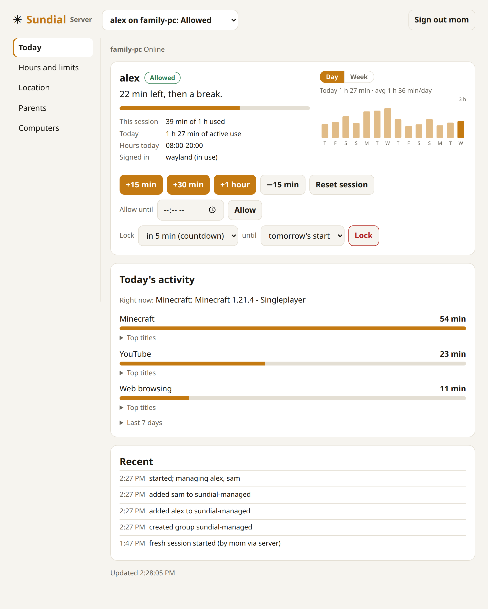

#  Sundial Server

The optional parent server for [Sundial](https://github.com/kz6fittycent/sundial), which sets screen time limits on Linux computers. The child's computer connects out to the server, so parents can see and change things wherever the child is. Limits keep working when the server can't be reached.

> **Work in progress.** There is no snap or release yet. Let's Encrypt certificates are planned; the server uses a self-signed certificate today. The child's computer needs Sundial's `two-snaps` branch, not a released version.

## Screenshots

The accounts and activity shown are made up.

| Parent page | On a phone, dark mode |
|---|---|
|  |  |

Adding a computer:


## How it works

- One server can manage several computers. Each shows the same information and controls as Sundial's own page, activity included.
- Only the server needs to be reachable. Nothing is opened on the child's computer or network.
- A change made while a computer is offline waits for it. Extra time expires after 30 minutes, so it can't turn up the next day.
- The pairing code works once, for 15 minutes. With a self-signed certificate it also lets the computer recognize the server.

## Build

```sh
git clone https://github.com/kz6fittycent/sundial-server
cd sundial-server
cargo build --release
sudo target/release/sundial-server run
```

Then open `https://<server>:8461/` from your home network. The first visit sets up the parents. `sundial-server passwd NAME` works too.

## Versions

Versions are `x.y.z`. The patch number goes up to 9, then the minor number goes up (0.1.9 → 0.2.0).

More in the [wiki](https://github.com/kz6fittycent/sundial-server/wiki).

## License

GPL-3.0-or-later. See [LICENSE](LICENSE).
